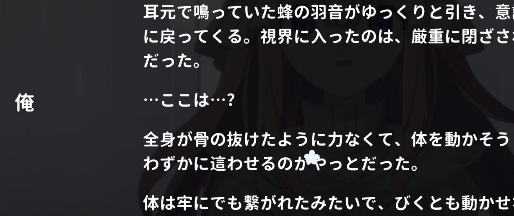
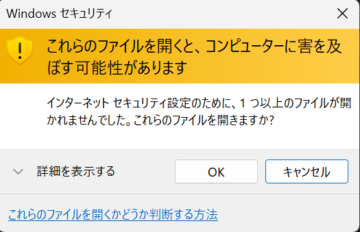
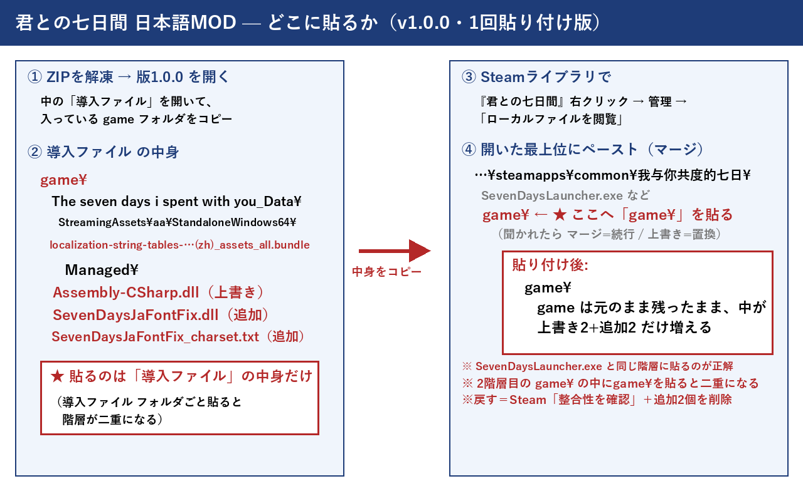
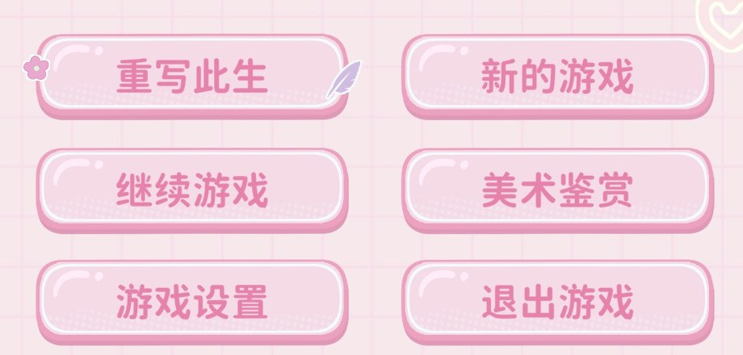
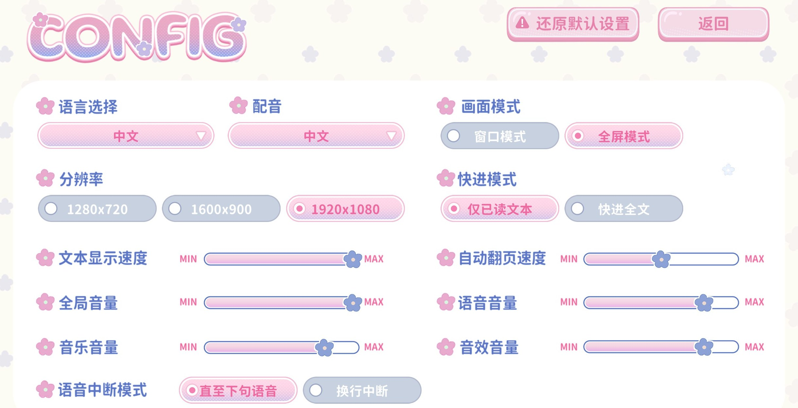
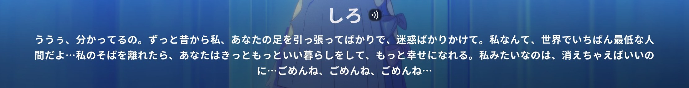

# 君との七日間 日本語化MOD

Steam 版 **『君との七日間』**（我与你共度的七日 / RErevue_studio・LoveStoryProject）の
**本文を日本語で読めるようにする非公式MOD**です。

ファイルを上書き・追加するだけで適用でき（**貼り付けは1回**）、
**Steamの「ゲームファイルの整合性を確認」で完全に元に戻ります**。
実行基盤（プラグインローダ等）は**不要**です。

| 項目 | 内容 |
|---|---|
| 対応 | Steam 版『君との七日間』（appid 3946810） |
| 導入 | `導入ファイル` の中身（game フォルダ1個）をゲームフォルダに1回貼り付けるだけ |
| 実行基盤 | 不要（ダウンロード不要・インストーラ不使用） |
| ゲーム内言語 | 起動後の言語設定で**简体中文**を選ぶ（このMODは简体中文のデータに日本語を載せています） |
| 元に戻す | Steamの「ゲームファイルの整合性を確認」＋追加ファイル2個の削除（下記） |
| ファイル | 合計 約0.7 MB（内訳は下の「中身」参照） |
| 版 | v1.0.0（2026-11-23） |

適用すると、本文はこのように日本語で表示されます。



## 先に：公式日本語版について

Steam ストアページには『君との七日間』の**日本語版が制作中**であることが明記されています（2026-11-23 日本語ページ実測）。
**急いで遊ばない方・待てる方は、公式日本語版を待つことをおすすめします。**
本MODは「今すぐ日本語で読みたい」方のためのファン翻訳であり、翻訳・表示とも個人制作の品質です。
公式日本語版が出たら、下の「元に戻す」手順で本MODを消せば正式版に移行できます（本MODはゲームの更新・アップロードの妨げになりません）。

---

## ダウンロード

**方法1（かんたん）** — このページ右上の **`Code` → `Download ZIP`**（コード → ZIPでダウンロード）
でリポジトリ全体を取得し、`版1.0.0` フォルダの中身を使います。

**方法2（ファイルだけ欲しい場合）** — 下の **`版1.0.0`** フォルダを開き、`導入ファイル` の中の
階層どおりにファイルが入っているので、必要なファイルを開いて右上の **ダウンロードボタン**
（Download raw file）を押します（そのままゲーム内の同じ階層へ置けます）。

> GitHub の `Download ZIP` はリポジトリ全体のZIPです（特定フォルダだけ落とすことはできません）。
> 更新版が出た場合も、同じ `版1.0.0`→新しい版フォルダを上書きする手順のままです。
> `版1.0.0` フォルダには上の導入ファイルのほか、`README.txt`（導入手順・元に戻し方の単体説明）と
> `LICENSE.txt`（個々のファイルの権利関係）が入っています。

### ZIP を開くときの警告について

Windows では、ダウンロードした ZIP を開くときに次の警告が出ることがあります。



これは**インターネットからダウンロードしたファイルに Windows が付ける印**によるもので、
中身が危険という意味ではありません。本MODの中身は**テキストの表データ・表示用の小さなコード・
説明テキストのみ**で、インストーラ形式のプログラム（.exe や .bat）は入っていません。

- そのまま **「OK」** を押して解凍して構いません。一度解凍すれば、そのあとは警告は出ません。

---

## 使い方（貼り付けは1回だけです）



### 1. ゲームを終了する

### 2. ゲームのフォルダを開く

Steam ライブラリで『君との七日間』を右クリック → **管理** → **ローカルファイルを閲覧**

### 3. 「導入ファイル」の中身を、そこに貼り付ける

ZIPを解凍し、`版1.0.0\導入ファイル` フォルダを**開いて**、中に入っている
**`game` フォルダを1個だけ**を、ステップ2で開いたフォルダ（`SevenDaysLauncher.exe` がある場所）に
コピーします。**「マージしますか？」→ 続行、「上書きしますか？」→ 差し替え** で進めば完了です。

```
導入ファイル\
 └─ game\
     └─ The seven days i spent with you_Data\
         ├─ StreamingAssets\aa\StandaloneWindows64\
         │   └─ localization-string-tables-chinese(simplified)(zh)_assets_all.bundle  （上書き）
         └─ Managed\
             ├─ Assembly-CSharp.dll            （上書き）
             ├─ SevenDaysJaFontFix.dll         （追加）
             └─ SevenDaysJaFontFix_charset.txt （追加）
```

> `導入ファイル` **フォルダごと**貼ると階層が二重になるので、必ず「中身（game フォルダ）」を貼ってください。
> 貼り付け後に増える／変わるファイルは上の4個だけで、他のゲームファイルには一切触れません。

### 4. ゲームを起動し、言語設定で「简体中文」を選ぶ

日本語で表示されます。Steam側の言語設定を変更する必要はありません。
（実機検証済み：冒頭から選択肢・確認ダイアログ・名前タグ「俺」まで日本語表示、文字化け・欠字なし）

> **上級者向け**：ゲーム本体の `Assembly-CSharp.dll` を上書きしたくない場合は、
> `導入ファイル` の中の**言語テーブル1ファイルだけ**を同じ階層どおりに貼る形でも使えます。
> ただしこの場合、地の文（ナレーション）行の**ひらがな部分が空白**になります
> （ゲーム本体のフォントに日本語ひらがなが無いため。推奨は上の1回貼り付けです）。

---

## 元に戻す

1. Steam ライブラリで『君との七日間』を右クリック → **プロパティ** → **インストール済みファイル** →
   **ゲームファイルの整合性を確認**。上書きした2ファイル（言語テーブルと `Assembly-CSharp.dll`）は
   Steam 管理の下で純正版に**復元**されます。
2. 追加した `SevenDaysJaFontFix.dll` と `SevenDaysJaFontFix_charset.txt` は Steam が管理していないため、
   `Managed\` フォルダから**手で削除**してください。

- セーブデータはMODの有無に関係なくそのまま使えます（既存セーブでの継続を実機で確認済み）。

---

## 何が変わる／変わらない

**日本語になるもの**

- 本編のセリフ・地の文・モノローグ、選択肢、名前タグ
- 回想（バックログ）の本文
- 確認ダイアログ（「記憶を読み込みますか？」など、**セーブのことは作中表現に合わせて「記憶」と表示されます**）

**原文のままになるもの（仕様です）**

- **タイトルメニュー、各種ボタン、設定画面（Config）の項目文字**（重写此生／新的游戏／继续游戏、SKIP、AUTO、設定画面の音量・画面モード・テキスト速度など。これらの文字はゲームの画面に直接組み込まれていて、本文用の言語テーブルに含まれないため、そのまま表示されます）。
  ※設定画面を開いたときに出てくる**確認ダイアログ**（「設定を初期化しますか？」等）は言語テーブルに含まれるため、日本語で表示されます。
- **音声**（中国語音声のままです。公式にも日本語ボイスは未実装です）
- **画像に焼き込まれた文字**（タイトルロゴ等。簡体中文版のままです）
- **Steam実績の名前**（公式13件。Steam側の表記のため英語名です）
- 立ち絵・背景などのグラフィックそのもの

**タイトルメニュー・設定画面は、それぞれこのように原文のままです。**





名前タグつきの台詞や地の文は、このように表示されます。



---

## 実績について

Steam 実績は公式13件があります。本MODは表示テキストとフォントのみを扱い、
実績の判定コードは変更していません。**MOD適用プレイ中にSteam実績が正常に解除されることを実機で確認済みです**（2026-11-23）。

---

## 翻訳・表示の品質について（既知の限界）

本MODの翻訳は、**LLM に中国語原文から直接日本語訳を生成させた**ものです
（機械翻訳エンジン（Google 翻訳等）は通していません）。原文と訳文の行対応・名前プレースホルダ・
用語の一貫性は機械検査で行単位に検証し、日本語としての不自然な箇所は目視で修正しています。
そのうえで、次の限界があることをご了承ください。

- 漢字・熟語の表現は意訳寄りで、原文の語感から離れている箇所があります
- 慣用表現・詩的な比喩・言い回しの取り違えが完全に抜けていない可能性があります
- キャラクターの感情の強さ（叫び・語気の上げ方）は、原文の記号に完全には合わせていません
- 標準の手順（1回貼り付け）ではフォント調整もすべて入りますので、この件を意識する必要はありません。
  「上級者向け」の書き方（言語表のファイルだけ入れる）で導入した場合のみ、地の文（ナレーション）の
  ひらがなの部分が空白になります（ゲーム同梱のフォントに日本語のひらがなが無いため）

**見つけたら [Issues](../../issues) で教えていただければ、次回更新で反映します。**
（行番号が分かる場合はスクリーンショットといっしょに貼ってください）

---

## 権利・免責

- 本MODは**非公式のファンメイド翻訳**です。RErevue_studio／LoveStoryProject および Steam とは無関係です。
- **ゲームのグラフィック・音声・映像は含んでいません。**
  同梱するのは、翻訳済みの言語テーブルデータ、表示用フォントを準備する小さなコード（自作）、
  およびその説明ファイルのみです。ゲームから差し替える `Assembly-CSharp.dll` は
  起動時に自作コードを1回呼す命令を足した**改造版**で、ファイル自体は開発元に帰属します。
- ゲーム・アセットの著作権は **RErevue_studio／LoveStoryProject** に帰属します。
  同梱ファイル1個ごとの権利関係は [版1.0.0/LICENSE.txt](版1.0.0/LICENSE.txt) に書いてあります。
- **本MODの再配布・販売（改変の有無・無料有料を問わず）は禁止します。** 他の方に共有する場合は、**このページへのリンク**をご利用ください。改造版を含む同梱物を他所へ置くことについては、権利面（改造 `Assembly-CSharp.dll` が開発元ファイルの派生物である点）を踏まえてこの方針としています。
- ただし**ご自身で使うための改変**（表記の変更・自分で読むための編集）や、
  **正常に動くようにするための解析・デバッグ**は妨げません。
- 自己責任でご利用ください。本MODの使用によって生じた損害について作者は責任を負いません。
- 掲載しているゲーム画面は、説明のための**引用**です（© RErevue_studio）。権利者のご要請があれば速やかに削除します。

---

## 権利者様へ

本MODは非公式のファンメイド翻訳であり、原作の権利を侵害する意図は一切ありません。
ゲーム本体（グラフィック・音声・プログラム）は含んでおらず、翻訳テキストとフォント処理のみを配布しています。

権利者の方で、**本MODの公開に問題があるとお考えの場合は、下記までご連絡ください。**

- GitHub の Issue：このページ上部の **Issues** タブ

ご連絡をいただいた場合は、内容を確認のうえ、**異議なく速やかに公開を停止・削除**します。

---

## クレジット

- 翻訳：個人によるファンメイド翻訳（LLM に中国語原文から直接訳出させ、機械検査と目視確認を併用）
- 原作：RErevue_studio／LoveStoryProject『君との七日間』

---

## 更新履歴

- **v1.0.0**（2026-11-23） 初版
